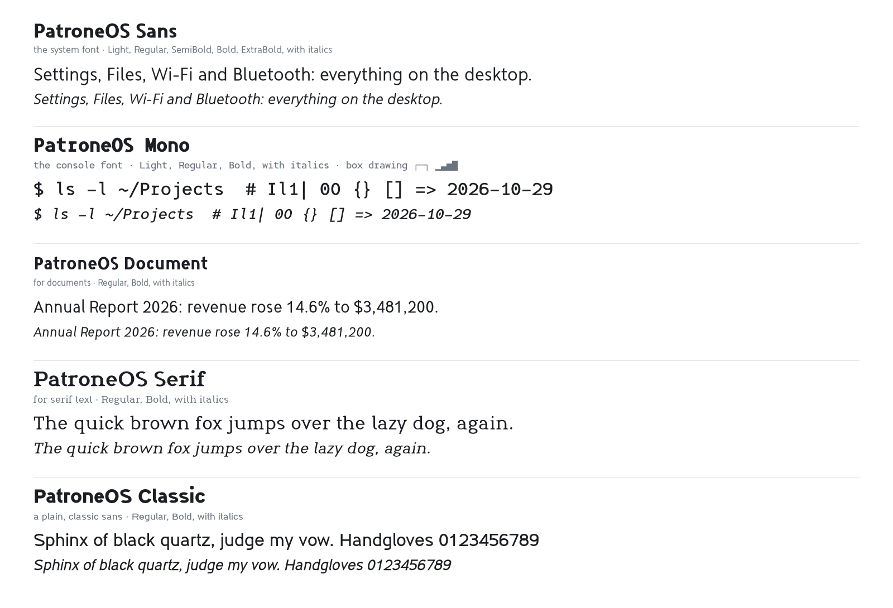

# PatroneOS fonts



Five font families made for [PatroneOS](https://patroneos.com), free for
anyone to use, change and share under the
[SIL Open Font License 1.1](OFL.txt).

| Family | For | Styles |
| --- | --- | --- |
| PatroneOS Sans | the desktop and apps | Light, Regular, SemiBold, Bold, ExtraBold, each with an italic |
| PatroneOS Mono | terminals and code, one width throughout | Light, Regular, Bold, each with an italic |
| PatroneOS Document | documents | Regular, Bold, each with an italic |
| PatroneOS Serif | serif text | Regular, Bold, each with an italic |
| PatroneOS Classic | a plain, classic sans | Regular, Bold, each with an italic |

Every family has a tailed l, so I, l, 1 and | all differ, and no zero is
slashed. They cover Latin-1 and Latin Extended-A, with the common
punctuation and symbols. The Mono has the box-drawing and block characters
too.

## Download

Get **PatroneOS-Fonts-1.1.0.zip** from the
[latest release](https://github.com/billsecond/patroneos-fonts/releases/latest).
It holds all five families as TrueType fonts, with the licence and the
FONTLOG. Web fonts (WOFF2) are in [fonts/webfonts](fonts/webfonts).

To install them on Linux, copy the folders from the zip into
`~/.local/share/fonts`. On other systems, open a font file and choose
Install.

## Build

The fonts are drawn from scratch, in code: every letter is a pen stroke
along a skeleton, outlined by the code in [source](source). On Linux, with
python3 and curl:

```
./build.sh
```

It puts its tools in a venv in `~/.cache/patroneos-fonts` (the network is
needed the first time; no sudo), and writes the fonts to
[fonts/ttf](fonts/ttf) and [fonts/webfonts](fonts/webfonts). `./build.sh
--zip` also makes the release zip, in `dist/`. A rebuild of a commit gives
the same fonts.

[FONTLOG.txt](FONTLOG.txt) says more about how the fonts are made, and
their history.

## Licence

Copyright 2026 William Daugherty. The fonts are licensed under the
[SIL Open Font License, Version 1.1](OFL.txt).
